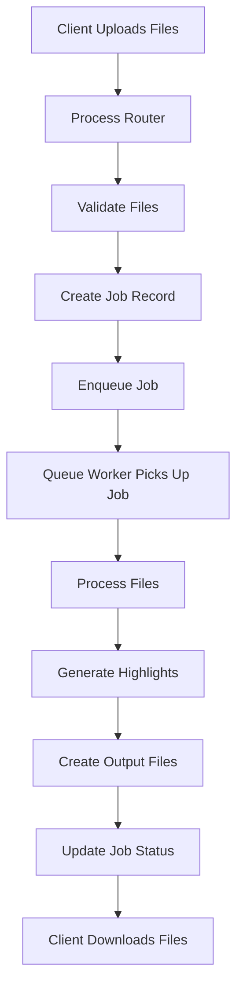
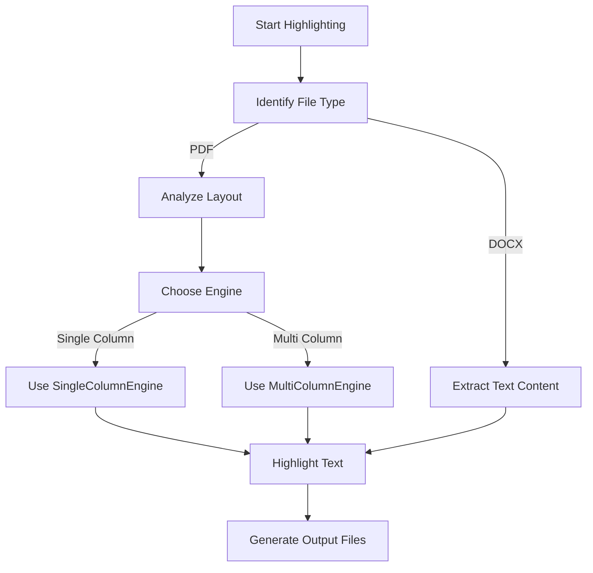

# Backend Working Documentation

## Quick Navigation

- [Project Overview](#project-overview)
- [Project Structure](#project-structure)
- [Architecture](#system-architecture)
- [API Endpoints](#api-layer-routers)
- [Business Logic Layer](#business-logic-layer-services)
- [Core System Components](#core-system-components-core)
- [Data Access Layer](#data-access-layer-repositories)
- [Highlighting Engines](#highlighting-engines)
- [Configuration](#configuration)
- [Data Flow](#data-flow)
- [Key Features](#key-features)
- [Dependencies](#dependencies)
- [Running the System](#running-the-system)
- [Monitoring and Maintenance](#monitoring-and-maintenance)
- [API Documentation](#api-documentation)
- [Conclusion](#conclusion)

## Project Overview

This document provides a detailed explanation of the backend working of the Batch Highlighter API project. The system is designed to process and highlight data in PDF and DOCX files based on input Excel data, with support for both single-column and multi-column PDF layouts.

## Project Structure

The backend is built with FastAPI and follows a modular architecture:

```
batch_highlighter_api_integrated/
├── main.py                 # FastAPI application entry point
├── requirements.txt        # Project dependencies
├── app/
│   ├── api.py             # API configuration and initialization
│   ├── routers/           # API endpoints
│   │   ├── process_router.py     # File processing endpoints
│   │   ├── progress_router.py    # Job progress endpoints
│   │   ├── download_router.py    # File download endpoints
│   │   └── misc_router.py        # Miscellaneous endpoints
│   ├── services/          # Business logic services
│   │   ├── job_queue.py          # Job queue management
│   │   ├── queue_worker.py       # Queue worker implementation
│   │   ├── worker.py             # Background task workers
│   │   ├── multi_column_engine.py   # Multi-column PDF highlighting
│   │   ├── single_column_engine.py  # Single-column PDF highlighting
│   │   ├── pdf_highlighter.py    # PDF highlighting base functionality
│   │   ├── pdf_highlighter_decider.py  # Decides which engine to use
│   │   └── docx_highlighter.py   # DOCX file highlighting
│   ├── core/              # Core system components
│   │   ├── config.py            # Configuration management
│   │   ├── state.py             # Application state management
│   │   ├── exceptions.py        # Custom exception definitions
│   │   ├── error_codes.py       # Error code definitions
│   │   ├── exception_handlers.py # Global exception handlers
│   │   └── utils.py             # Utility functions
│   ├── schemas/           # Pydantic models for request/response
│   │   └── process_schemas.py   # File processing schemas
│   ├── dependencies/      # Dependency injection
│   │   └── service_factory.py   # Service factory for dependency injection
│   ├── repositories/      # Data access layer
│   │   └── job_repository.py    # Job data repository
│   ├── config/            # Configuration files
│   │   ├── settings.py          # Application settings
│   │   └── logging_config.py    # Logging configuration
│   └── output/            # Output file handling
├── input/                 # Input files directory
├── output/                # Output files directory
└── logs/                  # Log files directory
```

## System Architecture

### 1. Entry Point - [`main.py`](batch_highlighter_api_integrated/main.py:1)

The application starts with `main.py`, which initializes the FastAPI application with production-ready settings:

```python
def main():
    """
    Main entry point.
    
    Starts the Uvicorn server with production-ready settings.
    """
    from app.config.settings import get_settings
    
    settings = get_settings()
    is_production = settings.environment == "production"
    
    uvicorn_config = {
        "host": settings.host,
        "port": settings.port,
        "log_level": settings.logging.level.lower(),
        "workers": settings.workers,
    }
    
    if is_production:
        uvicorn_config["reload"] = False
        uvicorn_config["access_log"] = True
    else:
        uvicorn_config["reload"] = settings.reload
        uvicorn_config["access_log"] = False
    
    uvicorn.run("main:app", **uvicorn_config)
```

**Application Creation - [`api.py`](batch_highlighter_api_integrated/app/api.py:1):**
```python
def create_app() -> FastAPI:
    app = FastAPI(
        title="Batch Highlighter API",
        description="API for batch document highlighting and annotation",
        version="1.0.0",
        docs_url="/docs",
        redoc_url="/redoc",
        openapi_url="/openapi.json",
    )
    
    # CORS middleware
    app.add_middleware(
        CORSMiddleware,
        allow_origins=["*"],
        allow_credentials=True,
        allow_methods=["*"],
        allow_headers=["*"],
    )
    
    # Include routers
    api_prefix = "/api/v1"
    app.include_router(misc_router, prefix=api_prefix)
    app.include_router(process_router, prefix=api_prefix)
    app.include_router(progress_router, prefix=api_prefix)
    app.include_router(download_router, prefix=api_prefix)
    
    # Startup/shutdown events
    @app.on_event("startup")
    async def startup_event():
        await start_queue_workers()
    
    @app.on_event("shutdown")
    async def shutdown_event():
        await stop_queue_workers()
    
    # Health endpoints
    @app.get("/health", response_model=HealthResponse, tags=["Health"])
    async def health_check():
        return HealthResponse(status="healthy", version="1.0.0")
    
    return app
```

### 2. API Layer - routers/

#### Process Router - [`process_router.py`](batch_highlighter_api_integrated/app/routers/process_router.py:1)

Handles file processing requests with full job lifecycle management:

```python
# Key endpoints:
- POST /api/v1/process - Start a new processing job
- GET /api/v1/process/{job_id} - Get job status
- GET /api/v1/process - List all jobs
- POST /api/v1/process/{job_id}/pause - Pause a processing job
- POST /api/v1/process/{job_id}/resume - Resume a paused job
- POST /api/v1/process/{job_id}/cancel - Cancel a job
```

Core functionality:
- Validates and stores input files in `input/` directory
- Loads and validates Excel/CSV data
- Extracts values/value pairs from data
- Submits jobs to queue with background processing
- Manages job metadata and status

**Job Creation Flow:**
```python
async def process_files():
    job_id = str(uuid.uuid4())
    # Save uploaded files
    data_temp = await save_uploaded_file(data_file, job_id)
    file_paths = []
    for doc in documents:
        fp = await save_uploaded_file(doc, job_id)
        file_paths.append(fp)
    
    # Validate and extract data
    df = load_data_file(data_temp)
    columns = validate_columns(df, selected_columns)
    vals, pairs = extract_values(df, columns)
    
    # Start background processing
    background_tasks.add_task(run_background_processing, data_temp, file_paths, 
                             selected_columns, selected_color, destination_folder, job_id)
    
    return ProcessResponse(
        message="Processing started",
        job_id=job_id,
        total_values=len(vals) if vals else None,
        total_pairs=len(pairs) if pairs else None,
        total_files=len(documents)
    )
```

#### Progress Router - [`progress_router.py`](batch_highlighter_api_integrated/app/routers/progress_router.py:1)

Provides job progress and log retrieval:

```python
# Key endpoints:
- GET /api/v1/progress - Get detailed progress (supports job ID parameter)
- GET /api/v1/progress/logs - Get processing logs

# Query parameters:
- job_id: Optional job ID for concurrent job tracking
- limit: Number of logs to return (default: 5000)
```

**Progress Response Structure:**
```python
class ProcessingStatus:
    running: bool
    paused: bool
    progress: float
    status: str
    job_id: Optional[str]
    start_time: Optional[float]
    end_time: Optional[float]
    completed: bool
    current_file: Optional[str]
    files_processed: int
    total_matches_found: int
    completion_summary: Optional[Dict[str, Any]]
    logs: List[Dict[str, Any]]
    combined_log: str
    not_found_report: str
    output_files: List[Dict[str, str]]
```

**Key Features:**
- Job-specific state tracking using asyncio locks
- Fallback to global state for backward compatibility
- Log retrieval with pagination
- Real-time progress tracking via periodic polling

#### Miscellaneous Router - [`misc_router.py`](batch_highlighter_api_integrated/app/routers/misc_router.py:1)

Provides utility endpoints:

```python
# Key endpoints:
- GET /api/v1/misc/health - Health check for frontend server detection
- POST /api/v1/misc/load-columns - Load column names from data file

# Health check:
@router.get("/health")
async def health_check():
    """Health check endpoint for frontend server detection"""
    return {"status": "healthy", "service": "batch-highlighter-api"}

# Column loading:
@router.post("/load-columns")
async def load_columns(file: UploadFile = File(...)):
    """Load column names from Excel or CSV file"""
    # Saves file temporarily, reads first row, returns column names
    return {"columns": list(df.columns)}
```

#### Download Router - [`download_router.py`](batch_highlighter_api_integrated/app/routers/download_router.py:1)

Handles file download requests with secure file access:

```python
# Key endpoints:
- GET /api/v1/download/{job_id} - Download all processed files as zip
- GET /api/v1/download/{job_id}/matches - Download matches CSV
- GET /api/v1/download/{job_id}/missing - Download missing values CSV
- GET /api/v1/download/{job_id}/source - Download source files

# File handling operations:
- Secure file path validation to prevent path traversal
- MIME type detection
- Content-Disposition headers for proper download handling
- File not found error handling
```

### 3. Business Logic Layer - services/

#### Job Queue - [`job_queue.py`](batch_highlighter_api_integrated/app/services/job_queue.py:1)

Manages job queue operations with support for multiple backends:

```python
class JobStatus(Enum):
    PENDING = "pending"
    PROCESSING = "processing"
    COMPLETED = "completed"
    FAILED = "failed"
    CANCELLED = "cancelled"
    PAUSED = "paused"

@dataclass
class Job:
    job_id: str
    user_id: Optional[str] = None
    status: JobStatus = JobStatus.PENDING
    created_at: str = ""
    started_at: Optional[str] = None
    completed_at: Optional[str] = None
    progress: float = 0.0
    result: Optional[Dict[str, Any]] = None
    error: Optional[str] = None
    data: Optional[Dict[str, Any]] = None
```

**Key Implementations:**
- `FairJobQueue`: Fair in-memory queue with proper worker distribution
- `InMemoryJobQueue`: Simple in-memory queue (legacy)
- `RedisJobQueue`: Redis-based queue for production multi-instance deployments

**Queue Factory:**
```python
def get_job_queue() -> JobQueue:
    """Get the global job queue instance based on configuration."""
    if settings.database.enabled and settings.database.type == "redis":
        return RedisJobQueue(settings.database.redis_url)
    else:
        return FairJobQueue()  # For better worker distribution
```

#### Queue Worker - [`queue_worker.py`](batch_highlighter_api_integrated/app/services/queue_worker.py:1)

Background worker that processes jobs from the queue:

```python
class QueueWorker:
    def __init__(self, max_workers: int = 4):
        self.max_workers = max_workers
        self.queue: Optional[JobQueue] = None
        self.pdf_service = PDFHighlighter()
        self.docx_service = DOCXHighlighter()
        self.running = False
        self.workers: List[asyncio.Task] = []
    
    async def start(self):
        """Start the worker pool."""
        pass
        
    async def stop(self):
        """Stop the worker pool."""
        pass
    
    async def _worker_loop(self, worker_id: int):
        """Worker loop that processes jobs."""
        while self.running:
            job = await self.queue.dequeue()
            if job:
                await self._process_job(job)
    
    async def _process_job(self, job):
        """Process a single job with pause/resume support."""
        try:
            job.status = JobStatus.PROCESSING
            await self._execute_processing(job.data, job.job_id)
            job.status = JobStatus.COMPLETED
        except Exception as e:
            job.status = JobStatus.FAILED
            job.error = str(e)
    
    async def _execute_processing(self, data: dict, job_id: str = None) -> dict:
        """Execute the actual document processing."""
        files = data.get("files", [])
        columns = data.get("columns", "")
        color = data.get("color", "Yellow")
        values = data.get("values", [])
        
        for idx, file_info in enumerate(files):
            if await self._check_and_handle_pause(job_id, (idx / len(files)) * 100):
                return {"paused": True}
                
            filepath = file_info.get("path")
            if filepath.endswith(".pdf"):
                matches, logs, output_path = self.pdf_service.highlight(
                    path=filepath,
                    data=values,
                    column_names=columns,
                    color_rgb=color_rgb,
                    original_filename=original_name,
                    idx=idx + 1,
                    job_id=job_id
                )
            elif filepath.endswith(".docx"):
                matches, logs, output_path = self.docx_service.highlight(
                    path=filepath,
                    data=values,
                    column_names=columns,
                    color=color,
                    original_filename=original_name,
                    idx=idx + 1,
                    job_id=job_id
                )
        
        # Save CSV reports
        combined_log_path = _save_combined_log(all_logs, dest_folder, columns, job_id)
        not_found_report_path = _save_not_found_report(not_found, dest_folder, columns, job_id)
        
        return {
            "total_files": total_files,
            "total_matches": total_matches,
            "not_found_count": len(not_found),
            "not_found_report": not_found_report_path,
            "combined_log": combined_log_path
        }
```

#### Worker - [`worker.py`](batch_highlighter_api_integrated/app/services/worker.py:1)

Handles the actual file processing:

```python
class Worker:
    def process_files(self, job_id, files):
        # Process uploaded files
        pass
        
    def validate_files(self, files):
        # Validate input files
        pass
        
    def generate_output_files(self, job_id, results):
        # Generate output files
        pass
```

#### Highlighting Engines

##### PDF Highlighter - [`pdf_highlighter.py`](batch_highlighter_api_integrated/app/services/pdf_highlighter.py:1)

Main service that coordinates PDF highlighting:

```python
class PDFHighlighter:
    def highlight(self, path: str, data: list, column_names: str, color_rgb: tuple, 
                 original_filename: str, idx: int, job_id: str, highlight_padding: int):
        """Main highlight method that routes to appropriate engine."""
        # Uses PDFHighlighterDecider to select single or multi-column engine
        pass
```

##### Single Column Engine - [`single_column_engine.py`](batch_highlighter_api_integrated/app/services/single_column_engine.py:1)

Handles PDF files with single-column layouts:

```python
class SingleColumnEngine:
    def highlight_pdf(self, pdf_path, highlights):
        # Highlight single-column PDF
        pass
        
    def extract_text(self, pdf_path):
        # Extract text from single-column PDF
        pass
```

##### Multi Column Engine - [`multi_column_engine.py`](batch_highlighter_api_integrated/app/services/multi_column_engine.py:1)

Advanced engine for multi-column PDF layouts with complex table detection:

```python
class MultiColumnEngine:
    def highlight_pdf(self, pdf_path, highlights):
        # Highlight multi-column PDF
        pass
        
    def detect_columns(self, page_image):
        # Detect column structure in PDF page
        pass
        
    def extract_column_text(self, page, columns):
        # Extract text from specific columns
        pass
        
    def detect_tables(self, page):
        # Detect and process table structures
        pass
```

##### PDF Highlighter Decider - [`pdf_highlighter_decider.py`](batch_highlighter_api_integrated/app/services/pdf_highlighter_decider.py:1)

Intelligent routing to appropriate highlighting engine:

```python
class PDFHighlighterDecider:
    def select_engine(self, pdf_path):
        """Decide whether to use single or multi-column engine."""
        # Analyze PDF characteristics
        # Return "single" or "multi" engine type
        pass
        
    def analyze_pdf_layout(self, pdf_path):
        """Analyze PDF page structure and complexity."""
        pass
```

##### DOCX Highlighter - [`docx_highlighter.py`](batch_highlighter_api_integrated/app/services/docx_highlighter.py:1)

Handles DOCX file highlighting:

```python
class DocxHighlighter:
    def highlight_document(self, docx_path, highlights):
        # Highlight DOCX document
        pass
        
    def extract_text(self, docx_path):
        # Extract text from DOCX
        pass
```

### 4. Core System Components - core/

#### Configuration - [`config.py`](batch_highlighter_api_integrated/app/core/config.py:1)

Manages application configuration:

```python
class Settings:
    app_name: str = "Batch Highlighter API"
    version: str = "1.0.0"
    # Database and API configuration
    # File storage settings
    # Processing engine settings
```

#### State Management - [`state.py`](batch_highlighter_api_integrated/app/core/state.py:1)

Manages application state with support for concurrent job processing:

```python
@dataclass
class ProcessingState:
    """Structured processing state with job-specific information."""
    running: bool = False
    paused: bool = False
    progress: float = 0.0
    status: str = "Idle"
    logs: List[Dict[str, Any]] = field(default_factory=list)
    combined_log: Optional[str] = None
    not_found_report: Optional[str] = None
    dest_folder: str = ""
    selected_color: str = "Yellow"
    job_id: Optional[str] = None
    start_time: Optional[float] = None
    end_time: Optional[float] = None
    completed: bool = False
    current_file: Optional[str] = None
    files_processed: int = 0
    total_matches_found: int = 0
    completion_summary: Optional[Dict[str, Any]] = None
    current_job_pdfs: List[str] = field(default_factory=list)
    
    def to_dict(self) -> Dict[str, Any]:
        return asdict(self)
```

**Key Features:**
- Job-specific state management using asyncio locks for thread safety
- Legacy global state for backward compatibility
- Job state cleanup after completion

**Color Presets:**
```python
COLOR_PRESETS = {
    "Yellow": {"pdf_rgb": (1.0, 1.0, 0.2), "word_val": "yellow", "docx_enum": "yellow"},
    "Green":  {"pdf_rgb": (0.66, 1.0, 0.33), "word_val": "green", "docx_enum": "green"},
    "Cyan":   {"pdf_rgb": (0.4, 1.0, 1.0),  "word_val": "cyan", "docx_enum": "cyan"},
    "Pink":   {"pdf_rgb": (1.0, 0.6, 0.86), "word_val": "magenta", "docx_enum": "magenta"},
    "Blue":   {"pdf_rgb": (0.6, 0.85, 1.0), "word_val": "blue", "docx_enum": "blue"},
    "Red":    {"pdf_rgb": (1.0, 0.55, 0.55), "word_val": "red", "docx_enum": "red"},
}
```

#### Exceptions - [`exceptions.py`](batch_highlighter_api_integrated/app/core/exceptions.py:1)

Custom exception classes:

```python
class ProcessingException(Exception):
    # Base processing exception

class FileValidationException(ProcessingException):
    # File validation error

class JobNotFoundException(ProcessingException):
    # Job not found error
```

#### Error Codes - [`error_codes.py`](batch_highlighter_api_integrated/app/core/error_codes.py:1)

Standardized error code definitions:

```python
class ErrorCode:
    # Processing errors
    FILE_NOT_FOUND = "FILE_NOT_FOUND"
    INVALID_FILE_TYPE = "INVALID_FILE_TYPE"
    
    # Job errors
    JOB_NOT_FOUND = "JOB_NOT_FOUND"
    JOB_ALREADY_EXISTS = "JOB_ALREADY_EXISTS"
    
    # Validation errors
    MISSING_REQUIRED_FIELD = "MISSING_REQUIRED_FIELD"
```

### 5. Data Access Layer - repositories/

#### Job Repository - [`job_repository.py`](batch_highlighter_api_integrated/app/repositories/job_repository.py:1)

Manages job persistence:

```python
class JobRepository:
    def create_job(self, job_data):
        # Create a new job record
        pass
        
    def update_job(self, job_id, updates):
        # Update job record
        pass
        
    def get_job(self, job_id):
        # Retrieve job by ID
        pass
```

### 6. Dependency Injection - dependencies/

#### Service Factory - [`service_factory.py`](batch_highlighter_api_integrated/app/dependencies/service_factory.py:1)

Provides service instances:

```python
class ServiceFactory:
    def get_job_queue(self):
        # Get job queue instance
        pass
        
    def get_worker_manager(self):
        # Get worker manager instance
        pass
        
    def get_job_repository(self):
        # Get job repository instance
        pass
```

## Data Flow

### Job Processing Workflow



### File Processing Steps

1. **File Validation**: Checks file types, sizes, and content validity
2. **Job Creation**: Creates job metadata and stores in database
3. **Job Queuing**: Places job in Redis queue for processing
4. **Background Processing**: Worker processes job from queue
5. **Document Analysis**: Determines document type and layout
6. **Text Extraction**: Extracts text for highlighting
7. **Highlight Generation**: Creates highlighted versions
8. **Output Generation**: Generates CSV files for matches and missing values
9. **Job Completion**: Updates job status and notifies client

### Highlighting Process



## Key Features

### 1. Multi-Format Support

- **PDF Files**: Supports both single-column and multi-column layouts
- **DOCX Files**: Full Word document highlighting
- **Excel Files**: Input data validation and processing

### 2. Intelligent Layout Detection

The system automatically detects:
- Single vs multi-column PDF layouts
- Complex table structures
- Various font sizes and styles
- Document orientation (portrait/landscape)

### 3. Performance Optimizations

- Asynchronous job processing
- Redis-backed job queue
- Background worker processes
- File caching and reuse
- Efficient text extraction algorithms

### 4. Error Handling

- Comprehensive error codes
- Detailed error messages
- Job retry logic
- Failed job recovery

### 5. Real-Time Monitoring

- Job progress tracking
- WebSocket updates
- Detailed logs
- Performance metrics

## Request/Response Schemas - schemas/

#### Process Schemas - [`process_schemas.py`](batch_highlighter_api_integrated/app/schemas/process_schemas.py:1)

Pydantic models for request/response validation:

```python
# Request models
class ProcessRequest(BaseModel):
    selected_columns: str
    selected_color: str = "Yellow"
    destination_folder: Optional[str] = None

# Response models
class ProcessResponse(BaseModel):
    message: str = "Processing started"
    job_id: str
    total_values: Optional[int] = None
    total_pairs: Optional[int] = None
    total_files: int
    progress_url: str = "/api/v1/progress"
    status_url: str = "/api/v1/status"
    links: dict = Field(default_factory=dict)

class JobStatusResponse(BaseModel):
    job_id: str
    status: str
    progress: float = Field(0, ge=0, le=100)
    created_at: Optional[str] = None
    started_at: Optional[str] = None
    completed_at: Optional[str] = None
    result: Optional[dict] = None
    error: Optional[str] = None

class ProcessResult(BaseModel):
    job_id: str
    status: str
    progress: float
    total_files: int
    processed_files: int
    total_matches: int
    unmatched_values: Optional[List[str]] = None
    unmatched_pairs: Optional[List[tuple]] = None
    output_files: List[str] = Field(default_factory=list)
    logs: List["ProcessingLog"] = Field(default_factory=list)

class ProcessingStatus(BaseModel):
    running: bool
    paused: bool
    progress: float
    status: str
    job_id: Optional[str] = None
    start_time: Optional[str] = None
    end_time: Optional[str] = None
    completed: bool = False
    current_file: Optional[str] = None
    files_processed: int = 0
    total_matches_found: int = 0
    completion_summary: Optional[dict] = None
    logs: list = Field(default_factory=list)
    combined_log: str = ""
    not_found_report: str = ""
    output_files: list = Field(default_factory=list)

class HighlightMatch(BaseModel):
    file: str
    page: Optional[str] = None
    paragraph: Optional[str] = None
    matched_value: Optional[str] = None
    matched_pair: Optional[str] = None
    output_file: Optional[str] = None
    note: Optional[str] = None
    timestamp: str

class ProcessingLog(BaseModel):
    file: str
    page_paragraph: Optional[str] = ""
    columns: str
    matched_value: Optional[str] = ""
    matched_pair: Optional[str] = ""
    timestamp: float
    output_file: Optional[str] = ""
    note: Optional[str] = ""
    error_code: Optional[str] = ""
```

## Configuration

The application uses a nested settings structure from [`settings.py`](batch_highlighter_api_integrated/app/config/settings.py:1):

```python
class Settings:
    # Application settings
    app_name = "Batch Highlighter API"
    app_version = "1.0.0"
    debug = False
    host = "0.0.0.0"
    port = 8000
    reload = False
    environment = "development"
    workers = 8
    
    # Database configuration
    class Database:
        enabled = False
        type = "sqlite"
        sqlite_path = "jobs/"
        redis_url = "redis://localhost:6379"
    
    # Storage configuration
    class Storage:
        base_output_dir = "app/output"
        temp_dir = "temp"
        max_file_size_mb = 100
    
    # Security configuration
    class Security:
        allowed_origins = ["*"]
        api_key_enabled = False
        api_key = ""
    
    # Highlight configuration
    class Highlight:
        padding = 5.0  # Highlight padding in points
    
    # Logging configuration
    class Logging:
        level = "INFO"
        format = "%(asctime)s - %(name)s - %(levelname)s - %(message)s"
        file_path = "logs/app.log"
        max_bytes = 10 * 1024 * 1024  # 10MB
        backup_count = 5
```

**Environment Variables (.env file):**
```
# Application
APP_NAME="Batch Highlighter API"
APP_VERSION="1.0.0"
DEBUG="false"
HOST="0.0.0.0"
PORT=8000
RELOAD="false"
ENVIRONMENT="development"
WORKERS=8

# Database
DATABASE__ENABLED="false"
DATABASE__TYPE="sqlite"
DATABASE__SQLITE_PATH="jobs/"
DATABASE__REDIS_URL="redis://localhost:6379"

# Storage
STORAGE__BASE_OUTPUT_DIR="app/output"
STORAGE__TEMP_DIR="temp"
STORAGE__MAX_FILE_SIZE_MB=100

# Security
SECURITY__ALLOWED_ORIGINS="*"
SECURITY__API_KEY_ENABLED="false"
SECURITY__API_KEY=""

# Highlight
HIGHLIGHT_PADDING=5.0

# Logging
LOGGING__LEVEL="INFO"
LOGGING__FORMAT="%(asctime)s - %(name)s - %(levelname)s - %(message)s"
LOGGING__FILE_PATH="logs/app.log"
LOGGING__MAX_BYTES=10485760
LOGGING__BACKUP_COUNT=5
```

## Running the System

### Prerequisites

1. Python 3.9+
2. Redis server (for production job queue)
3. Required dependencies (install via `pip install -r requirements.txt`)

### Startup Scripts

- **Windows**: [`start_cluster.bat`](batch_highlighter_api_integrated/start_cluster.bat) - Starts Redis, workers, and API server
- **Linux/macOS**: [`start_cluster.sh`](batch_highlighter_api_integrated/start_cluster.sh) - Starts Redis, workers, and API server

### Manual Startup (Development Mode)

```bash
# Install dependencies
pip install -r requirements.txt

# Start application directly
python main.py

# Or using uvicorn directly with custom settings
uvicorn main:app --host 0.0.0.0 --port 8000 --reload --workers 4
```

### Configuration Files

- **`.env`**: Environment-specific configuration
- **`config/settings.py`**: Default settings and validation
- **`config/logging_config.py`**: Logging configuration

### Cluster Management

For distributed processing:
```bash
# Run cluster manager
python run_cluster.py

# Clear memory and temporary files
clean_memory.bat  # Windows
# or
rm -rf temp/  # Linux/macOS
```

## Monitoring and Maintenance

### Logging

Logs are stored in [`logs/app.log`](batch_highlighter_api_integrated/logs/app.log) with levels:
- INFO: Normal operation
- WARNING: Potential issues
- ERROR: Error conditions
- DEBUG: Detailed debugging information

### Health and Monitoring

#### Health Endpoints

```bash
# Check if API is running
curl -X GET http://localhost:8000/health

# Check if system is ready for requests
curl -X GET http://localhost:8000/ready

# Get worker information
curl -X GET http://localhost:8000/worker-info
```

#### Real-Time Progress Tracking

```bash
# Get job progress (WebSocket or polling)
curl -X GET http://localhost:8000/api/v1/progress/{job_id}

# Get detailed job progress with logs
curl -X GET http://localhost:8000/api/v1/progress/{job_id}/details
```

#### Metrics and Logs

- **Application Logs**: [`logs/app.log`](batch_highlighter_api_integrated/logs/app.log)
- **Worker Logs**: Separate log files per worker
- **Metrics**: Available via `/api/v1/metrics` endpoint (if enabled)

#### Job Lifecycle

```python
# Job status transitions:
Pending → Processing → Completed
Pending → Processing → Paused → Processing → Completed
Pending → Processing → Failed
Pending → Cancelled
```

### Memory Management

Use [`clean_memory.bat`](batch_highlighter_api_integrated/clean_memory.bat) to clear temporary files and memory.

## API Documentation

Full API documentation is available at:
- Swagger UI: `http://localhost:8000/docs`
- ReDoc: `http://localhost:8000/redoc`

See [`API_DOCUMENTATION.md`](batch_highlighter_api_integrated/API_DOCUMENTATION.md) for detailed API reference.

## Data Access Layer - repositories/

#### Job Repository - [`job_repository.py`](batch_highlighter_api_integrated/app/repositories/job_repository.py:1)

Manages job persistence with support for multiple storage backends:

```python
@dataclass
class Job:
    """Job model for tracking processing jobs."""
    job_id: str
    status: str  # pending, running, paused, completed, failed
    progress: float = 0.0
    total_files: int = 0
    processed_files: int = 0
    total_values: int = 0
    matched_values: int = 0
    unmatched_values: List[str] = field(default_factory=list)
    output_files: List[str] = field(default_factory=list)
    logs: List[Dict[str, Any]] = field(default_factory=list)
    error: Optional[str] = None
    created_at: str = field(default_factory=lambda: datetime.now().isoformat())
    updated_at: str = field(default_factory=lambda: datetime.now().isoformat())
    completed_at: Optional[str] = None
```

**Storage Options:**
- In-memory storage (default)
- File-based storage (JSON files)
- Database storage (SQLite/Redis)

#### Worker - [`worker.py`](batch_highlighter_api_integrated/app/services/worker.py:1)

Background worker for direct file processing (legacy API support):

```python
class ProcessingWorker:
    """Worker class for processing files in background."""
    
    def __init__(self, worker_id: str = "Worker-Main"):
        self.pdf_service = PDFHighlighter()
        self.docx_service = DOCXHighlighter()
        self.job_repo = None
    
    async def process_files(
        self,
        data: List[Union[str, Tuple[str, str]]],
        doc_files: List[str],
        dest_folder: Optional[str],
        selected_columns: str,
        selected_color: str,
        job_id: Optional[str] = None
    ):
        # Handles both single and multi-column highlighting
        pass
```

## Dependency Injection - dependencies/

#### Service Factory - [`service_factory.py`](batch_highlighter_api_integrated/app/dependencies/service_factory.py:1)

Provides dependency injection using protocols for loose coupling:

```python
@runtime_checkable
class PDFServiceProtocol(Protocol):
    """Protocol for PDF highlighting service."""
    def highlight(self, path: str, data: list, column_names: str, color_rgb: tuple, 
                 original_filename: str, idx: int):
        ...

@runtime_checkable
class DOCXServiceProtocol(Protocol):
    """Protocol for DOCX highlighting service."""
    def highlight(self, path: str, data: list, column_names: str, color: str, 
                 original_filename: str, idx: int):
        ...

class ServiceFactory:
    """Factory for creating service instances."""
    
    @classmethod
    def get_pdf_service(cls) -> PDFServiceProtocol:
        """Get PDF highlighting service instance."""
        if cls._pdf_service is None:
            cls._pdf_service = PDFHighlighter()
        return cls._pdf_service
    
    @classmethod
    def get_docx_service(cls) -> DOCXServiceProtocol:
        """Get DOCX highlighting service instance."""
        if cls._docx_service is None:
            cls._docx_service = DOCXHighlighter()
        return cls._docx_service
```

**Benefits:**
- Easy to swap implementations
- Supports mocking for testing
- Loose coupling between components

## Error Handling - core/

### Custom Exceptions - [`exceptions.py`](batch_highlighter_api_integrated/app/core/exceptions.py:1)

Custom exception hierarchy for structured error handling:

```python
class AppException(HTTPException):
    """Base exception for application errors."""
    def __init__(self, status_code: int, detail: str, code: str, headers: Optional[dict] = None):
        super().__init__(status_code=status_code, detail=detail, headers=headers)
        self.code = code

class FileException(AppException):
    """Exception for file-related errors."""
    def __init__(self, detail: str, code: str = "FILE_ERROR", file_path: Optional[str] = None):
        self.file_path = file_path
        super().__init__(...)

class FileNotFoundException(FileException):
    """Exception when file is not found."""
    def __init__(self, file_path: str):
        super().__init__(f"File not found: {file_path}", "FILE_NOT_FOUND", file_path)

class ValidationException(AppException):
    """Exception for validation errors."""

class ProcessingException(AppException):
    """Exception for processing errors."""

class ConfigurationException(AppException):
    """Exception for configuration errors."""
```

### Error Codes - [`error_codes.py`](batch_highlighter_api_integrated/app/core/error_codes.py:1)

Standardized error codes with categories and descriptions:

```python
ERROR_CATEGORIES = {
    "FILE_ERROR": "File operation errors",
    "DATA_ERROR": "Data processing errors",
    "VALIDATION_ERROR": "Input validation errors",
    "PROCESSING_ERROR": "Document processing errors",
    "SYSTEM_ERROR": "System or unexpected errors",
    "NETWORK_ERROR": "Network-related errors",
    "AUTHENTICATION_ERROR": "Authentication and authorization errors",
    "CONFIGURATION_ERROR": "Configuration-related errors"
}

ERROR_CODES = {
    "FILE_NOT_FOUND": {"category": "FILE_ERROR", "title": "File Not Found", ...},
    "FILE_INVALID_FORMAT": {"category": "FILE_ERROR", "title": "Invalid File Format", ...},
    "VALIDATION_MISSING_FIELD": {"category": "VALIDATION_ERROR", "title": "Missing Required Field", ...},
    "PROCESSING_FAILED": {"category": "PROCESSING_ERROR", "title": "Processing Failed", ...},
    "SYSTEM_MEMORY_ERROR": {"category": "SYSTEM_ERROR", "title": "Memory Error", ...}
}
```

### Exception Handlers - [`exception_handlers.py`](batch_highlighter_api_integrated/app/core/exception_handlers.py:1)

Global exception handlers for consistent error responses:

```python
async def app_exception_handler(request: Request, exc: AppException) -> JSONResponse:
    """Handle custom application exceptions."""
    logger.error(f"App exception: code={exc.code}, detail={exc.detail}", exc_info=True)
    
    return JSONResponse(
        status_code=exc.status_code,
        content={
            "error": {
                "code": exc.code,
                "message": exc.detail,
                "path": str(request.url.path)
            }
        }
    )

async def file_exception_handler(request: Request, exc: FileException) -> JSONResponse:
    """Handle file-related exceptions with file path information."""
    pass

async def validation_exception_handler(request: Request, exc: ValidationException) -> JSONResponse:
    """Handle validation exceptions with field-specific details."""
    pass
```

## Dependencies

### Core Dependencies

```
# Web framework
fastapi==0.100.0
uvicorn==0.23.2

# Document processing
PyMuPDF==1.22.5
python-docx==0.8.11
pandas==2.0.3

# Data handling
openpyxl==3.1.2
csv==1.0

# Job queueing
redis==5.0.1

# Background processing
asyncio

# Logging and monitoring
structlog==23.1.0

# Utilities
python-multipart==0.0.6
python-jose==3.3.0
passlib==1.7.4
python-dotenv==1.0.0
```

### Optional Dependencies

- **Redis**: For production job queue (install via system package manager)
- **Poppler**: For advanced PDF text extraction (optional)

## Conclusion

The backend system is designed for scalability and efficiency, handling large volumes of document processing tasks with intelligent highlighting capabilities. The modular architecture ensures maintainability and allows for easy addition of new features in the future. Key strengths include:

- **Asynchronous Processing**: Efficient job queueing and background processing
- **Intelligent Highlighting**: Multi-engine approach for different document layouts
- **Real-Time Monitoring**: WebSocket-based progress updates and detailed logging
- **Robust Error Handling**: Comprehensive exception handling and recovery mechanisms
- **Configurable Architecture**: Support for multiple deployment environments and storage backends